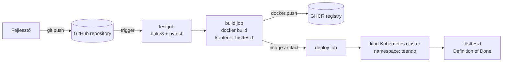

# DevOps projektfeladat – Dokumentáció

**Projekt:** Teendőlista mini alkalmazás end-to-end CI/CD pipeline-nal
**Kurzus:** DevOps
**Hallgató:** _<név, Neptun-kód>_
**Repository:** https://github.com/Mark22345/devops-teendo
**Pipeline futások:** https://github.com/Mark22345/devops-teendo/actions
**Dátum:** 2026. december

---

## 1. Összefoglaló

A projekt célja egy teljes körű (end-to-end) CI/CD folyamat megvalósítása. Az üzleti
alkalmazás szándékosan egyszerű: egy teendőkezelő webalkalmazás, amely REST API-n és egy
webes felületen keresztül teszi lehetővé teendők létrehozását, listázását, prioritás
szerinti rendezését, késznek jelölését, törlését és statisztika lekérdezését.

A hangsúly az automatizáláson van: minden `main` ágra történő `git push` hatására a
GitHub Actions pipeline emberi beavatkozás nélkül

1. ellenőrzi a kódminőséget (lint),
2. lefuttatja az automatikus teszteket (unit + API, lefedettségméréssel),
3. elkészíti a telepíthető artifactot (Docker image) és konténerként kipróbálja,
4. publikálja az image-et a GitHub Container Registry-be,
5. létrehoz egy Kubernetes sandbox környezetet (kind), telepíti oda az alkalmazást,
6. füstteszttel igazolja, hogy a telepített alkalmazás elindult és az üzleti funkciói elérhetők.

## 2. Felhasznált technológiák

| Terület | Eszköz | Indoklás |
|---|---|---|
| Verziókezelés | Git + GitHub | Iparági szabvány, a pipeline natívan integrált vele |
| Alkalmazás | Python 3.12, Flask 3 | Kevés kóddal teljes REST API készíthető |
| Alkalmazásszerver | Gunicorn | Éles környezetre alkalmas WSGI szerver (a Flask beépített szervere csak fejlesztésre való) |
| Tesztelés | pytest, pytest-cov | Unit- és API-tesztek, lefedettség mérése |
| Kódminőség | flake8 | Statikus kódelemzés, stílusellenőrzés |
| Konténerizáció | Docker | Reprodukálható, környezetfüggetlen artifact |
| CI/CD | GitHub Actions | Ingyenes, felhőben futó, YAML-ben leírt pipeline |
| Image registry | GitHub Container Registry (GHCR) | Az artifact verziózott tárolása |
| Sandbox célkörnyezet | Kubernetes – kind (Kubernetes in Docker) | Valódi Kubernetes cluster, amely a pipeline-on belül jön létre és szűnik meg |

## 3. Architektúra

### 3.1 Alkalmazás felépítése

- `app/service.py` – **üzleti logika** (`TodoService`): validáció (kötelező cím, max. 200
  karakter, engedélyezett prioritások), rendezés (nyitottak elöl, prioritás szerint),
  szűrés, statisztika. Szálbiztos (`threading.Lock`).
- `app/__init__.py` – **REST API** (Flask application factory). A hibákat egységes JSON
  válasszal kezeli (400 – hibás bemenet, 404 – nem létező elem).
- `app/templates/index.html` – egyszerű **webes felület**, amely az API-t hívja.
- `/health` végpont – a Docker HEALTHCHECK, a Kubernetes readiness/liveness probe és a
  füstteszt is ezt használja; visszaadja a futó verziót (commit SHA).

### 3.2 API

| Metódus | Útvonal | Leírás | Válasz |
|---|---|---|---|
| GET | `/health` | Állapot és verzió | 200 |
| GET | `/api/todos?status=open\|done` | Teendők listája | 200 / 400 |
| POST | `/api/todos` | Új teendő (`title`, `priority`) | 201 / 400 |
| GET | `/api/todos/<id>` | Egy teendő | 200 / 404 |
| PATCH | `/api/todos/<id>` | Módosítás (`title`, `priority`, `done`) | 200 / 400 / 404 |
| DELETE | `/api/todos/<id>` | Törlés | 204 / 404 |
| GET | `/api/stats` | Statisztika | 200 |

## 4. Verziókezelés és Git munkafolyamat

- Fő ág: `main` – mindig telepíthető állapotú; erre történő push indítja a teljes
  pipeline-t (test → build → deploy).
- Fejlesztés feature ágakon (`feature/<rövid-leírás>`), összeolvasztás Pull Requesttel.
  Pull Request esetén a pipeline a `test` és `build` lépést futtatja, a `deploy` lépést
  nem – így hibás kód nem kerül telepítésre.
- Commit üzenetek a *Conventional Commits* konvenció szerint (`feat:`, `fix:`, `test:`,
  `ci:`, `docs:`).
- `.gitignore` – generált és lokális fájlok kizárása; `.gitattributes` – a shell
  scriptek és YAML fájlok LF sorvéggel kerülnek a repóba (Windows alatt is), így a Linux
  runneren futtathatók.

## 5. A CI/CD pipeline részletesen

A pipeline definíciója: `.github/workflows/ci-cd.yml`.

**Indító események:** push a `main` ágra, Pull Request a `main` ágra, valamint kézi
indítás (`workflow_dispatch`).

### 5.1 `test` job – Lint és tesztek
1. Kód letöltése (`actions/checkout`), Python 3.12 telepítése pip cache-sel.
2. `flake8 app tests` – kódstílus és statikus hibák ellenőrzése.
3. `pytest` – 20+ teszteset (unit tesztek a `TodoService`-re és API tesztek a Flask
   test clienttel). A `--cov-fail-under=80` kapcsoló miatt a pipeline **elbukik**, ha a
   kódlefedettség 80% alá esik.
4. A JUnit XML és coverage riportokat a pipeline artifactként elmenti.

### 5.2 `build` job – Artifact előállítása
1. `docker build` – az image a commit SHA-val van taggelve, a verzió (`APP_VERSION`)
   bekerül az image-be, így a `/health` végponton látszik, melyik commit fut.
2. **Konténer füstteszt** – az image-ből konténer indul, és a `scripts/smoke_test.sh`
   végigpróbálja az üzleti funkciókat.
3. Az image `docker save`-vel pipeline-artifactként átkerül a `deploy` jobhoz.
4. `main` ágon az image publikálása a GHCR-be (`<sha>` és `latest` tag).

**Dockerfile jó gyakorlatok:** vékony alap image (`python:3.12-slim`), a függőségek
külön rétegben (gyorsabb újrabuildelés), nem root felhasználó (UID 10001), beépített
`HEALTHCHECK`, `.dockerignore` a felesleges fájlok kizárására.

### 5.3 `deploy` job – Telepítés a sandbox környezetbe
1. A `helm/kind-action` létrehoz egy egy-node-os **Kubernetes clustert** a runneren
   (`k8s/kind-config.yaml`); a 30080-as NodePort a runner 8080-as portjára van kivezetve.
2. Az image betöltése a clusterbe (`kind load docker-image`).
3. A manifestek alkalmazása: `namespace.yaml`, `deployment.yaml`, `service.yaml`.
   A deployment image-hivatkozását a pipeline a pontos commit SHA-ra cseréli.
4. `kubectl rollout status` – megvárja, amíg a pod a readiness probe szerint is kész.
5. **Füstteszt a telepített alkalmazáson** (lásd 6. fejezet).
6. A cluster állapota (`kubectl get all`, `describe`, logok) bekerül a pipeline
   naplójába, az eredmény pedig a futás *Summary* oldalára.

A job a GitHub `sandbox` nevű *environment*-jéhez tartozik, így a GitHub felületén a
telepítések története (Deployments) is nyomon követhető.

### 5.4 Kubernetes erőforrások
- **Namespace** `teendo` – az alkalmazás elkülönítése.
- **Deployment** – RollingUpdate stratégia, readiness és liveness probe a `/health`
  végponton, CPU/memória request és limit, `runAsNonRoot` biztonsági beállítás.
- **Service** (NodePort 30080) – az alkalmazás elérhetővé tétele a clusteren kívülről.

## 6. Definition of Done igazolása

A feladat szerint a projekt akkor kész, ha *a telepített artifact sikeresen elindul a
célkörnyezetben és elérhetővé teszi az üzleti funkcióit*. Ezt a `deploy` job utolsó
lépései automatikusan ellenőrzik a `scripts/smoke_test.sh` scripttel, a Kubernetes
Service-en keresztül:

| # | Ellenőrzés | Elvárt eredmény |
|---|---|---|
| 1 | `GET /health` (max. 60 mp várakozással) | 200, `status: ok` |
| 2 | `GET /` | A webes felület betölt |
| 3 | `POST /api/todos` | Teendő létrejön |
| 4 | `GET /api/todos` | Az új teendő szerepel a listában |
| 5 | `PATCH /api/todos/<id>` | `done: true` |
| 6 | `GET /api/stats` | A statisztika frissül |
| 7 | `DELETE /api/todos/<id>` | 204 |
| 8 | `POST /api/todos` üres címmel | 400 (hibakezelés működik) |

Ha bármelyik lépés hibázik, a pipeline piros lesz. A zöld `deploy` job tehát maga a
Definition of Done bizonyítéka.

**Képernyőképek (beillesztendő):**
- _[1. ábra – Az Actions fülön a sikeres pipeline futás (test → build → deploy)]_
- _[2. ábra – A deploy job füstteszt kimenete: „SIKER: az alkalmazás fut…”]_
- _[3. ábra – A futás Summary oldala]_
- _[4. ábra – Az image a GHCR-ben (Packages)]_
- _[5. ábra – A webes felület lokálisan futtatva]_

## 7. Hibakezelés és visszaállítás

- **Hibás kód** nem jut el a telepítésig: a jobok egymásra épülnek (`needs`), bármely
  lépés hibája megállítja a folyamatot.
- **Sikertelen rollout:** a readiness probe miatt a Kubernetes nem irányít forgalmat a
  hibás podra; a `rollout status` időtúllépéssel hibát jelez. Visszaállítás:
  `kubectl rollout undo deployment/teendo-app -n teendo`, illetve egy korábbi,
  SHA-val taggelt image újratelepítése.
- **Nyomonkövethetőség:** minden image a commit SHA-val van taggelve, és a futó verzió a
  `/health` végponton lekérdezhető.

## 8. Korlátok és továbbfejlesztési lehetőségek

- Az adatok memóriában tárolódnak, ezért újraindításkor elvesznek, és csak 1 replika
  futtatható konzisztensen. Továbbfejlesztés: PostgreSQL adatbázis (StatefulSet vagy
  menedzselt szolgáltatás), ezután horizontális skálázás (HPA).
- A kind cluster a pipeline végén megszűnik (ideiglenes sandbox). Tartós környezethez a
  manifestek változtatás nélkül telepíthetők bármely Kubernetes clusterre (pl. AKS, EKS,
  GKE) a GHCR-ben tárolt image-dzsel.
- További lehetőségek: biztonsági image-szkennelés (Trivy), Helm chart, staging →
  production többlépcsős környezetek jóváhagyással, monitoring (Prometheus/Grafana).

## 9. Futtatási útmutató

Lásd a `README.md` fájlt (GitHubra feltöltés, lokális futtatás, Docker).
